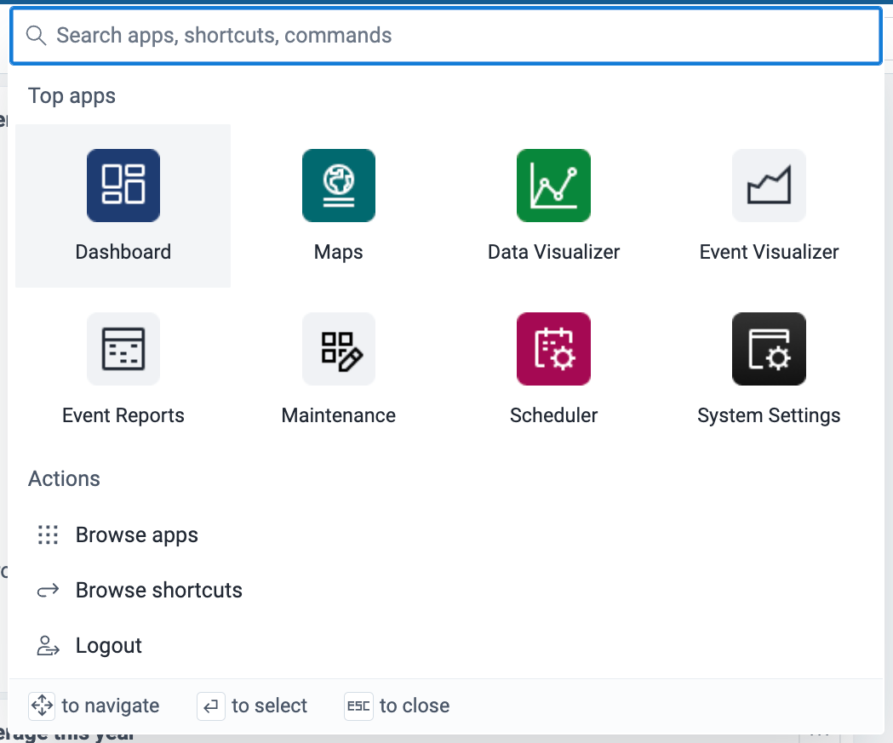
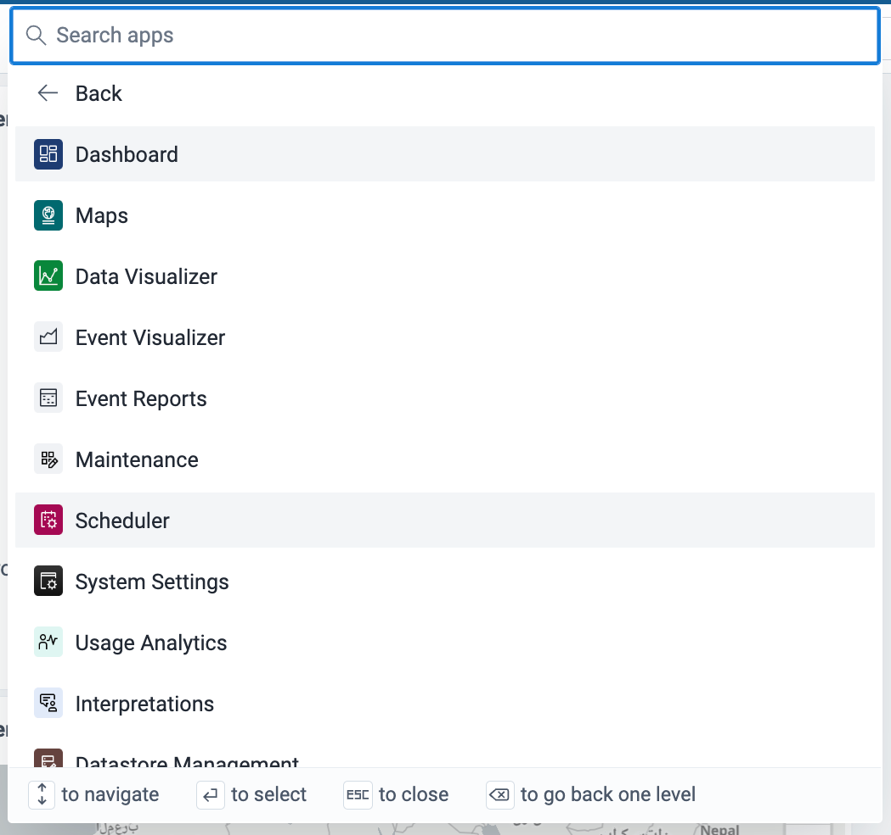
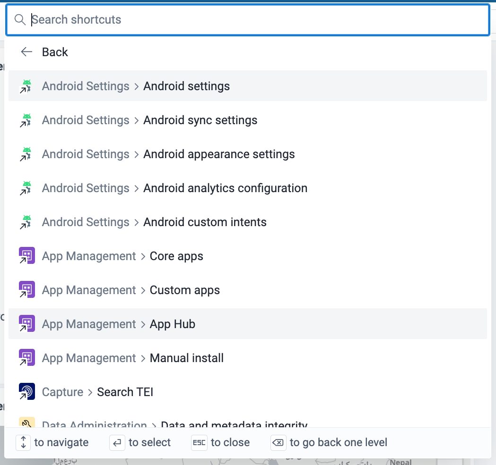

# Command palette { #command_palette }

The command palette is a search box and menu for moving around DHIS2. You can use it to open apps and app shortcuts, and to log out. It is part of the global shell, so it is available to all users in all apps. The command palette is available in DHIS2 v42 and later.

## Open the command palette

You can open the command palette in three ways:

1. Click the **apps icon** (a grid of nine dots, with the tooltip **Command palette**) in the header bar.

    { width=30% }

2. Press **Tab** until the apps icon has focus, then press **Enter**.
3. Press **Cmd + K** (Mac) or **Ctrl + K** (Windows and Linux) in any DHIS2 app.

## The command palette window

{ width=50% }

When it opens, the command palette shows four parts:

1. A search box at the top. It searches all items.
2. A grid of **Top apps**, with up to eight apps.
3. A list of **Actions**:

    - **Browse apps**: opens the list of all apps. This action shows only when the instance has more than eight apps.
    - **Browse shortcuts**: opens the list of all shortcuts. This action shows only when at least one app has a shortcut.
    - **Logout**: logs you out of DHIS2.

4. A key legend at the bottom. It shows the keys that you can use in the current view.

The search box also mentions commands. The palette does not have commands in DHIS2 v42 and v43, so the **Browse commands** action does not show.

## Search in the command palette

1. Type in the search box. The search is fuzzy, so it finds close matches, for example when you make a small spelling mistake.
2. Check the results. DHIS2 lists matching apps, each followed by that app's shortcuts. Matching shortcuts from other apps and matching actions follow.
3. To clear the search, press **Backspace** or **Delete**, or click the **clear** icon in the search box. To return to the main view, click **Back**, the first item in the results.

If nothing matches, the palette shows **Nothing found for** and the text that you typed.

## Browse apps

{ width=50% }

1. Choose **Browse apps**. The palette lists all apps on the instance.
2. To find an app in this list, type in the search box. The search covers apps only.
3. To go back to the main view, click **Back**.

## Browse shortcuts

{ width=50% }

A shortcut opens a specific page in an app. Each shortcut shows the app name and the page name, for example **Metadata Management > Categories**. Apps define their own shortcuts. To add shortcuts to your own app, see [Adding app shortcuts to the command palette](https://github.com/dhis2/app-platform/blob/master/docs/config/adding-shortcuts.md).

1. Choose **Browse shortcuts**. The palette lists all shortcuts on the instance.
2. To find a shortcut in this list, type in the search box. The search covers shortcuts only.
3. To go back to the main view, click **Back**.

## Choose an item

-   Click an action to run it.
-   Click an app or a shortcut to open it.
-   To open an app or a shortcut in a new browser tab, hold **Cmd** (Mac) or **Ctrl** (Windows and Linux) and click it.

## Use the keyboard

You can use the keyboard to move through the command palette:

-   In the grid of top apps, press the **Right**, **Left**, **Up**, and **Down** arrow keys.
-   In a list, press the **Up** and **Down** arrow keys.
-   Press **Enter** to open an app or shortcut, or to run an action.
-   In the **Browse apps** and **Browse shortcuts** views, press **Backspace** when the search box is empty to go back to the main view.

## Close the command palette

You can close the command palette in three ways:

-   Press **Esc**.
-   Click anywhere outside the command palette.
-   Press **Cmd + K** (Mac) or **Ctrl + K** (Windows and Linux).
